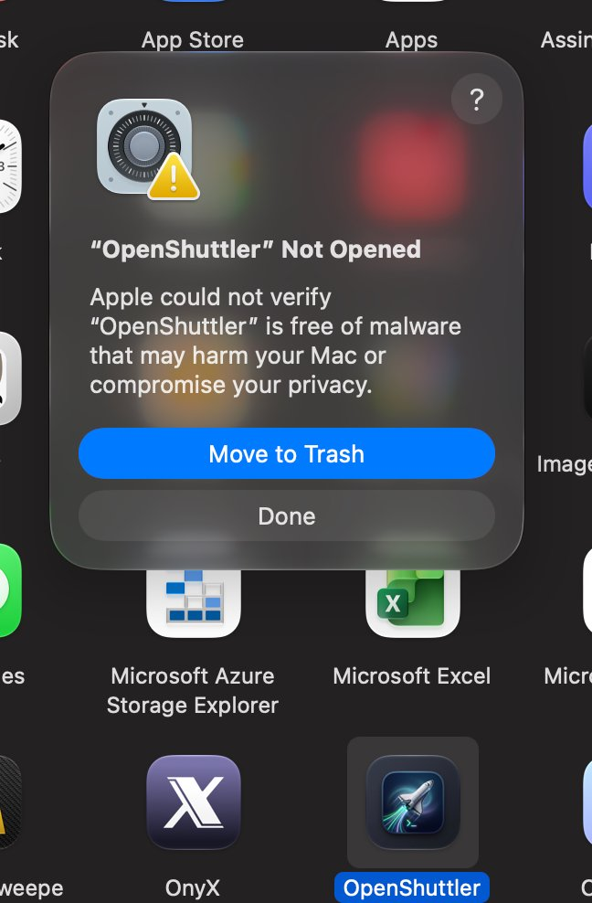

# OpenShuttler

<p align="center">
  
</p>

<p align="center">
  <b>A lightweight, blazing-fast native macOS menu bar app for managing and connecting to SSH servers with one click.</b><br>
  Built as a modern, high-performance successor to the classic <a href="https://github.com/fitztrev/shuttle">Shuttle</a>.
</p>

<p align="center">
  <a href="https://github.com/alessandrofalls/openshuttler/releases/latest"></a>
  <a href="https://github.com/alessandrofalls/openshuttler/actions/workflows/codeql.yml"></a>
  
  
  
  
  
</p>

---

## ✨ Features

* 🚀 **100% Native & Ultra-lightweight:** Written in pure Swift 6 with AppKit. Zero Electron, zero webviews, zero bloated runtimes. Consumes minimal memory (~10–20MB) and launches instantly.
* 🔑 **Your `~/.ssh/config` is First-Class:** Reads hosts directly from your existing OpenSSH configuration file. No need to duplicate server credentials or keep two configs in sync.
* 📁 **Submenus & Folder Grouping:** Organize servers neatly using comments (e.g. `# Group: Production`) or slash-delimited host aliases (`Host cloud/web-01`).
* 🏷️ **Friendly Display Names:** Define human-readable labels (`# Description: Primary Database`) while executing the exact SSH alias underneath.
* 💬 **Rich Tooltips:** Hover over any server to inspect username, target hostname/IP, port, and identity keys before connecting.
* 🖥️ **Flexible Window Management:**
  * **`tab` (Default):** Opens a new tab in your active terminal window (or creates a new window if none is open).
  * **`current`:** Runs the SSH command in your currently focused terminal tab/window.
  * **`new`:** Always launches a dedicated new terminal window.
* ⚡ **Instant Live Reload:** Edits to `~/.ssh/config` or app preferences automatically refresh the menu bar in real-time — no restart required.
* 🧩 **Multiple Terminal Support:** Works out of the box with macOS **Terminal.app** and **iTerm2**.
* ✏️ **Smart Config Editor:** Quick shortcut to edit configs in your favorite GUI or CLI editor (`vim`, `nvim`, `nano`, `code`, etc.). CLI editors automatically open inside an interactive terminal session.
* 🔄 **Zero-Hassle Migration:** Seamlessly migrates legacy configs from `~/.shuttle.json` and previous versions.

---

## 📥 Installation

### Option 1: Homebrew Cask (Recommended)

The cleanest and fastest way to install OpenShuttler on macOS without Gatekeeper prompts (using `--no-quarantine`):

```zsh
# 1. Tap the repository
brew tap alessandrofalls/openshuttler https://github.com/alessandrofalls/openshuttler

# 2. Trust the tap
brew trust alessandrofalls/openshuttler

# 3. Install OpenShuttler (bypasses Gatekeeper quarantine automatically)
brew install --cask --no-quarantine openshuttler
```

To update in the future:
```zsh
brew upgrade --cask openshuttler
```

---

### Option 2: Direct Download (DMG or ZIP)

No terminal required:

1. Go to the [**Releases**](https://github.com/alessandrofalls/OpenShuttler/releases/latest) page.
2. Download either package:
   * **`OpenShuttler-macOS-arm64.dmg`**: Open the disk image and drag **OpenShuttler** to your **Applications** folder.
   * **`OpenShuttler-macOS-arm64.zip`**: Extract the archive and place `OpenShuttler.app` into `/Applications`.
3. Open **OpenShuttler**. The terminal icon (`>_`) will appear in your top macOS menu bar.

> [!NOTE]
> ### 🛡️ First-Launch Notice: macOS Gatekeeper ("Cannot verify developer")
> Because OpenShuttler is a community open-source utility distributed without an Apple Developer ID signature (\$99/year), macOS Gatekeeper displays a security alert on the first launch:
>
> <p align="center">
>   <br>
>   <i>"Apple could not verify 'OpenShuttler' is free of malware..."</i>
> </p>
>
> You only need to approve it once using any of these simple methods:
>
> * **Method 1: Control-Click / Right-Click (Fastest & GUI)**:
>   1. Click **Done** on the alert (do not click *Move to Trash*).
>   2. Open Finder and go to your **Applications** folder.
>   3. Hold **Control** and click (or right-click) `OpenShuttler.app` and choose **Open**.
>   4. Click **Open** in the confirmation dialog. macOS will remember this decision permanently.
>
> * **Method 2: System Settings**:
>   1. Open macOS **System Settings** > **Privacy & Security**.
>   2. Scroll down to the **Security** section where OpenShuttler is listed as blocked.
>   3. Click **Open Anyway**.
>
> * **Method 3: Terminal (One command)**:
>   ```zsh
>   xattr -d com.apple.quarantine /Applications/OpenShuttler.app
>   ```

> [!IMPORTANT]
> **Terminal Automation Permission:**  
> When using `tab` or `current` window modes, macOS will ask for permission on your first connection to send Apple Events to Terminal or iTerm2. Click **Allow** to let OpenShuttler manage terminal tabs.

---

### Option 2: Build from Source

If you prefer to compile from source:

#### Prerequisites
* macOS 13.0 (Ventura) or newer on Apple Silicon (M1/M2/M3/M4).
* Xcode Command Line Tools installed (`xcode-select --install`).

#### Steps
```zsh
# 1. Clone the repository
git clone https://github.com/alessandrodourado/openshuttler.git
cd openshuttler

# 2. Build, code-sign, and install to ~/Applications/OpenShuttler.app
./build.sh --install

# 3. Launch OpenShuttler
open ~/Applications/OpenShuttler.app
```

---

## ⚙️ Configuration

OpenShuttler relies on two simple configuration mechanisms:
1. `~/.ssh/config` for server definitions and groups.
2. `~/.config/openshuttler/config.json` for application preferences.

### 1. Organizing Servers in `~/.ssh/config`

You can organize servers into menus and submenus directly within `~/.ssh/config`:

```ssh-config
# ==============================================================================
# Group: Cloud Production
# ==============================================================================

Host web-prod
  # Description: Main Web Server
  HostName 198.51.100.10
  User deploy
  IdentityFile ~/.ssh/id_ed25519

Host db-prod
  # Description: PostgreSQL Primary
  HostName 198.51.100.11
  User postgres
  Port 2222
  IdentityFile ~/.ssh/id_ed25519

# ==============================================================================
# Group: Staging
# ==============================================================================

Host staging-api
  # Description: QA API Gateway
  HostName 203.0.113.50
  User ubuntu
  IdentityFile ~/.ssh/staging.key

# Group: none
# Slash notation creates submenus automatically without comments:
Host infrastructure/bastion
  HostName bastion.example.com
  User ops
```

* **Folder / Group Submenus:** Use `# Group: Folder Name` above host blocks, or name the host with slashes (`Host Group/Server`). To return to root menu, use `# Group: none`.
* **Human-Readable Labels:** Add `# Description: Your Title` inside or above a `Host` block.
* **Include Directives:** `Include ~/.ssh/conf.d/*` directives are resolved recursively. Hosts in included files without explicit groups appear neatly at root.
* **Wildcards & Patterns:** Wildcard patterns like `Host *` or `Host *.internal` are automatically ignored by the menu.

---

### 2. Application Preferences (`~/.config/openshuttler/config.json`)

To open preferences, click the menu bar icon and select **Edit App Preferences…** (or press `Cmd+,`):

```json
{
  "version": 1,
  "openIn": "new",
  "sshConfigHosts": {
    "enabled": true,
    "ignoreHosts": [],
    "ignoreKeywords": []
  },
  "terminalApp": null,
  "editor": "vim",
  "servers": []
}
```

| Setting | Options | Description |
|---|---|---|
| `openIn` | `"new"`, `"tab"`, `"current"` | Window opening behavior: `"new"` (Default: dedicated clean window, **zero macOS permissions or accessibility prompts required**), `"tab"` (opens in a new tab; requires macOS Apple Events automation permission), or `"current"` (injects into the active tab). |
| `sshConfigHosts.enabled` | `true`, `false` | When `true`, automatically parses servers from `~/.ssh/config`. Set to `false` if you only want to load servers defined in the JSON file. Default: `true`. |
| `sshConfigHosts.ignoreHosts` | `["host1", ...]` | List of SSH host aliases to exclude from the menu. |
| `sshConfigHosts.ignoreKeywords` | `["tmp", ...]` | Substrings to ignore: hides any host alias containing these words. |
| `terminalApp` | `null`, `"Terminal"`, `"iTerm"` | Terminal application to use. If `null`, defaults to the system Terminal. |
| `editor` | `"vim"`, `"nano"`, `"code"`, `null` | Editor launched when clicking "Edit...". CLI editors (`vim`, `nano`, etc.) open directly in an interactive terminal. If `null`, uses the macOS default text editor. |
| `servers` | `[...]` | Optional list of custom shell commands or arbitrary non-SSH tunnels. |

---

## 🚀 How Releases Work (For Developers)

OpenShuttler includes a full GitHub Actions automated release pipeline (`.github/workflows/release.yml`).

To publish a new public release:

```zsh
# 1. Commit all your changes
git add .
git commit -m "feat: release v1.0.0"

# 2. Tag the commit with a version number
git tag v1.0.0

# 3. Push the commit and tag to GitHub
git push origin main
git push origin v1.0.0
```

GitHub Actions will automatically:
1. Spin up a clean macOS Apple Silicon runner.
2. Run unit tests (`swift test`).
3. Compile the production binary and create `build/OpenShuttler-macOS-arm64.zip`.
4. Create a new GitHub Release with release notes and attach the `.zip` binary ready for 1-click download.

---

## 🛠️ Architecture

OpenShuttler is designed with clean modular architecture and strict concurrency safety:

```text
Sources/
  ShutterCore/       # Pure domain logic (zero AppKit): ssh_config parser,
                     # models, validation, safe decoding, and launch planner.
  OpenShuttler/      # Presentation layer: NSStatusItem, AppKit menus,
                     # async launcher via osascript/open, and login items.
Tests/
  ShutterCoreTests/  # Comprehensive unit test suite (41 tests) covering
                     # parsing, malformed configs, escaping, and launch plans.
Resources/           # Info.plist and dynamically rendered AppIcon.icns.
scripts/             # Swift script for vector generation of high-res app icons.
```

* **Modern Concurrency:** Swift 6 mode with `@MainActor` and `Sendable` guarantees throughout.
* **Resilient Parsing:** Fault-tolerant JSON and SSH parsing. Malformed lines surface non-blocking menu warnings (`⚠️ 1 configuration warning`) instead of crashing.

---

## 🧪 Running Tests

To run the full unit test suite:

```zsh
swift test
```

---

## 🔒 Security & Privacy Guarantees

Because OpenShuttler manages SSH connections, security and transparency are fundamental:

* 🛡️ **Zero External Dependencies:** Built exclusively using Apple's official native frameworks (`Foundation`, `AppKit`, `OSLog`). No third-party pods, npm, or precompiled binary blobs that could introduce supply-chain vulnerabilities.
* 🌐 **100% Offline & Zero Telemetry:** Contains zero analytics, tracking, or network HTTP libraries. All network operations are conducted exclusively through your system's native `/usr/bin/ssh` binary.
* 🔑 **Zero Private Key Access:** OpenShuttler **never** reads, inspects, or caches private cryptographic keys (`id_rsa`, `id_ed25519`). It merely forwards the key path reference (`-i ~/.ssh/key`) to OpenSSH.
* 🛡️ **Strict POSIX Sanitization:** Host aliases, usernames, and commands are rigorously quoted and escaped to prevent command injection vulnerabilities.
* 🤖 **Automated Security Scanning:** Every pull request and release is automatically audited by [GitHub CodeQL](https://github.com/alessandrofalls/OpenShuttler/security/code-scanning) for static analysis and security vulnerabilities.
* 🔐 **Cryptographic Verification:** Every release includes verifiable `SHA256SUMS.txt` hashes for binary integrity verification.

---

## 📄 License

Distributed under the MIT License. See [LICENSE](LICENSE) for details.
